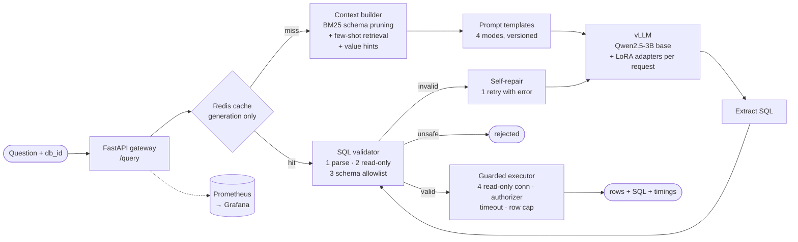

# Text-to-SQL LLM Platform

**Natural-language questions → safe SQL, with a measured answer to "prompting, RAG or
fine-tuning?". A 3B open model, fine-tuned and served on one 12 GB consumer GPU.**

[](https://github.com/Hardik1608/text-to-sql-llm-platform/actions)
[](https://www.python.org/)
[](LICENSE)

- **63.4% → 76.1%** execution accuracy on the [Spider](https://yale-lily.github.io/spider)
  test set (2,147 unseen questions): QLoRA fine-tuning **+9.5 pts**, schema RAG +3.2 pts on top.
- **6.1 queries/s** on vLLM at 16 parallel requests (**5×** single-request throughput), same accuracy.
- **4-stage SQL safety layer:** read-only by construction, **0.01%** false rejections on 9,693
  gold queries, ~4 ms per check.
- **Validation loss picked the wrong checkpoint:** the lowest-loss one scored 8 points lower, so
  the final weights are served.

https://github.com/user-attachments/assets/06fd9b75-4927-486c-bb74-6bb133ed5423

**Stack:** Qwen2.5-3B · PEFT/QLoRA · TRL · vLLM (per-request LoRA) · BM25 RAG · sqlglot ·
FastAPI · Redis · MLflow · Prometheus/Grafana · Docker Compose · GitHub Actions

## Documentation
| | |
|---|---|
| [Case study](docs/CASE_STUDY.md) | Design decisions, results, failure modes, lessons learned |
| [Architecture](docs/ARCHITECTURE.md) | Request path, training pipeline, deployment topology |
| [Training on an RTX 3060](docs/TRAINING_RTX3060.md) | Memory plan, time budget, step-by-step run, troubleshooting |
| [Running the stack](infra/README.md) | Docker Compose profiles (`gpu` / `cpu` / `tracking`), ports, alerts |
| [Results](docs/results/) | Test and dev benchmarks, checkpoint selection, vLLM serving, Docker check |
| [API](#api) | Endpoints and the web UI (interactive docs at `/docs` when running) |

---

## The Question

> *"Given a Text-to-SQL problem, when is prompting sufficient, when does RAG help, and when does
> PEFT fine-tuning become necessary?"*

The four modes form a **2 × 2 experimental design**, so each effect can be measured on its own
and in combination:

| | Full schema | Retrieval-augmented context |
|---|---|---|
| **Base model** (Qwen2.5-3B-Instruct) | `prompt` | `rag` |
| **QLoRA adapter** (`spider-v1-e3`) | `qlora` | `qlora_rag` |

Every mode runs through the **same serving pipeline**: retrieval, generation, safety layer and
guarded execution. The benchmark therefore measures the system that answers requests, not a
separate evaluation script.

---

## Architecture



Full diagrams (request path, training pipeline, deployment topology): [`docs/ARCHITECTURE.md`](docs/ARCHITECTURE.md)

---

## Benchmark Results

**Spider test set: 2,147 questions on 40 databases that the model never saw.** Qwen2.5-3B-Instruct
ran on one RTX 3060. No repair retries were used.

| Approach | Execution Acc. | Exact Match | Valid SQL | Prompt tokens |
|---|---|---|---|---|
| Base + Prompting | 63.4% | 29.0% | 87.4% | 577 |
| Base + Schema RAG | 66.9% | 38.5% | 88.0% | 491 |
| QLoRA Fine-Tuned | 72.9% | 50.1% | 92.9% | 354 |
| **QLoRA + Schema RAG** | **76.1%** | **50.0%** | **93.0%** | 491 |

- **Fine-tuning gives the largest gain:** +9.5 points over prompting. Schema RAG adds +3.5 points
  on the base model and +3.2 points on the adapter. Combined: **+12.7 points**.
- **The gains grow with difficulty:** on *hard* questions, 50.6% → 68.5%.
- **Validation loss picked the wrong checkpoint.** The lowest-loss checkpoint (step 100) scored
  67.5% on 200 dev questions; the final weights scored 75.5%, although their loss was 2× higher.
  The final weights are served.
- **One self-repair retry raises accuracy to 78.0%** and cuts hallucinated identifiers from 6.9%
  to 4.6%.

For scale: the best GPT-4-based systems score about 86% on the same test set
([DAIL-SQL](https://arxiv.org/abs/2308.15363): 86.6%). This project uses a 3B open model that is
trained and served on one 12 GB consumer GPU. Spider 1.0 is close to saturated; this
pipeline's single-shot mode is the baseline on [BIRD](https://bird-bench.github.io/) in the
follow-up project, [governed-data-agent](https://github.com/Hardik1608/governed-data-agent)
(49.1% single-shot vs 55.9% for the agent on all 1,534 BIRD dev questions).

| Serving on vLLM (one RTX 3060, QLoRA + RAG, 500 dev questions) | Throughput | P50 | P95 | Exec Acc |
|---|---|---|---|---|
| 1 request at a time | 1.22 q/s | 610 ms | 1.8 s | 75.0% |
| 16 parallel requests | **6.08 q/s** (5.0×) | 1.9 s | 5.9 s | 74.6% |

| Training (QLoRA, RTX 3060 12 GB) | |
|---|---|
| Runtime | 8.5 h, 3 epochs, 1,557 steps |
| Peak VRAM | **6.29 GB** |
| Trainable parameters | 29.9M (0.96% of 3.1B) |

Raw reports, latency per approach, accuracy by difficulty, the dev split and the Docker stack
check: [`docs/results/`](docs/results/). The test split was used for no decision.

### Component checks (reproducible on a CPU laptop)

| What | Result |
|---|---|
| Validator false rejections on **9,693** Spider gold queries (train + dev) | **0.01%** (1 query: a Spider annotation that names a table missing from the schema) |
| Re-serialized `safe_sql` returns the same result as the original | **100%** of executable gold queries |
| Validation latency (parse + read-only + schema allowlist) | **~4 ms** mean |
| Database routing over 206 databases (no `db_id` given) | top-1 **78.3%**, top-3 **89.0%** |
| Table-pruning recall (gold tables kept), `max_tables=6` + FK expansion | **100%** dev / **97.6%** train |

The validator rows are reproduced by `pytest tests/test_real_spider.py` (it needs the Spider
download).

---

## Tech Stack

| Layer | Tools |
|---|---|
| Base model | Qwen2.5-3B-Instruct |
| Fine-tuning | PEFT + TRL (SFT, completion-only loss) + bitsandbytes — QLoRA NF4, r=16 |
| Serving | vLLM (OpenAI-compatible, per-request LoRA, runtime adapter hot-swap); `hf_server.py` reference server for Windows |
| Retrieval | BM25 (Lucene IDF) over schemas + structural few-shot retrieval + database value index |
| Safety | sqlglot AST validation → read-only enforcement → schema allowlist → SQLite authorizer, timeout, row cap |
| API | FastAPI |
| Caching | Redis (generation cache; results are re-validated and re-executed on a hit) |
| Tracking | MLflow (training runs, adapter artifacts, benchmark runs) |
| Monitoring | Prometheus + Grafana (provisioned dashboard + alert rules) |
| Deployment | Docker Compose (`gpu` / `cpu` / `tracking` profiles) |
| CI/CD | GitHub Actions — ruff, pytest (3.11 + 3.12), config validation, image build |
| Dataset | Spider 1.0 (8,659 train / 1,034 dev / 2,147 test, 206 SQLite databases) |

---

## Quick Start

```bash
# 1. Environment
git clone https://github.com/Hardik1608/text-to-sql-llm-platform
cd text-to-sql-llm-platform
python -m venv .venv && source .venv/bin/activate     # Windows: .venv\Scripts\activate
pip install -r requirements.txt -r requirements-dev.txt

# 2. Spider (≈200 MB) -> data/processed/{train,dev,test}.jsonl + schemas.json
python -m src.ingestion.download_spider

# 3. Tests (no GPU, no network; uses a synthetic mini-Spider + a fake LLM)
pytest -q

# 4. Full stack: API + vLLM + Redis + Prometheus + Grafana   (see infra/README.md)
cp .env.example .env
docker compose --profile gpu up -d           # or --profile cpu (Ollama) on a laptop

# 5. Ask a question
curl -X POST http://localhost:8000/query \
  -H "Content-Type: application/json" \
  -d '{"question": "How many singers are there?", "db_id": "concert_singer", "mode": "qlora_rag"}'
```

Without Docker, point the API at any OpenAI-compatible server, for example Ollama on a laptop:

```bash
T2S_LLM_BASE_URL=http://localhost:11434/v1 T2S_BASE_MODEL=qwen2.5:3b T2S_REDIS_URL=memory:// \
  uvicorn api.main:app --port 8000
```

---

## Fine-Tuning

```bash
pip install -r requirements-train.txt                 # GPU box (torch with CUDA first)

# SFT data from Spider train: same ContextBuilder as inference, validation held out BY DATABASE
python -m src.finetuning.prepare_data                 # -> data/finetune/{train,val}.jsonl

# QLoRA (4-bit NF4, r=16, alpha=32, 3 epochs); tracks to MLflow; writes a vLLM-loadable adapter
python -m src.finetuning.train_lora --epochs 3 --output adapters/spider-v1-e3

# 4-way benchmark through the production pipeline
python -m src.evaluation.compare_approaches --split test --adapter spider-v1-e3 --mlflow
```

The served adapter is the **final** weights, not the lowest-validation-loss checkpoint: loss picked
step 100, which scored 8 points lower on execution accuracy
([`training_and_selection.md`](docs/results/training_and_selection.md)).

To serve it, put the adapter folder at `adapters/spider-v1-e3/` (it must contain
`adapter_config.json`) and set this in `.env`:

```bash
T2S_ADAPTERS=spider-v1-e3=/adapters/spider-v1-e3
```

`scripts/gpu_train.sh` runs the whole GPU flow in stages (`setup`, `data`, `smoke`, `probe`,
`train`, `eval`). Hardware notes, memory plan, time budget and troubleshooting:
[`docs/TRAINING_RTX3060.md`](docs/TRAINING_RTX3060.md).

---

## API

| Endpoint | Purpose |
|---|---|
| `GET /` | web UI; service info moved to `GET /info` |
| `POST /compare` | `{question, db_id}` → all 4 approaches side by side; graded against the gold SQL for Spider dev/test questions |
| `GET /databases/{db_id}/questions` | held-out Spider questions for a database (answer known) |
| `POST /query` | `{question, db_id?, mode, adapter?, execute, max_rows}` → SQL, rows, violations, per-stage timings, token usage |
| `GET /health`, `GET /ready` | liveness; readiness (LLM backend reachable) |
| `GET /metrics` | Prometheus metrics (`text2sql_*`) |
| `GET /databases`, `GET /databases/{db_id}` | catalog and CREATE TABLE schema |
| `GET /adapters`, `POST /adapters/load`, `POST /adapters/unload` | adapter registry; hot-swap on vLLM (`X-Admin-Token`) |

Request outcomes: `ok`, `rejected` (safety layer blocked the SQL), `exec_error`, `cannot_answer`,
`llm_error` (HTTP 503). Interactive docs at `http://localhost:8000/docs`.

**Web UI:** open `http://localhost:8000/`. Pick a database and an approach, then ask a question.
The page shows:
- the generated SQL;
- the safety verdict;
- the result table, or a single figure for "how many" questions;
- the time each pipeline stage took;
- the context the model saw: selected tables, value hints, retrieved examples.

The **Compare approaches** tab runs one question through all four approaches at once:
- each approach gets a column with its SQL, result, latency and tokens;
- for Spider's held-out questions, offered as clickable examples, the gold SQL is known, so each
  column is graded ✓/✗ with the benchmark's own execution-match rule;
- for other questions, the columns are grouped by agreement ("3 of 4 approaches agree").

It is three static files in `api/static/`, served by the same container, with no build step.

---

## Project Structure

```
text-to-sql-llm-platform/
├── api/
│   ├── main.py                  # FastAPI gateway
│   └── static/                  # web UI: index.html, app.js, styles.css (no build step)
├── src/
│   ├── schema.py                # structured schema model shared by every stage
│   ├── pipeline.py              # route → cache → retrieve → generate → validate → repair → execute
│   ├── factory.py, config.py    # wiring + T2S_* settings
│   ├── ingestion/               # Spider download + preprocessing
│   ├── retrieval/               # BM25, schema pruning, example retrieval, value index, context builder
│   ├── generation/              # prompt templates (4 modes), SQL extraction
│   ├── safety/                  # sql_validator.py (stages 1-3), executor.py (stage 4)
│   ├── serving/                 # vLLM client + adapter registry, Redis cache, metrics,
│   │                            #   4-way comparison (compare.py), hf_server
│   ├── finetuning/              # prepare_data.py, train_lora.py
│   └── evaluation/              # metrics (EX, EM, hardness), compare_approaches.py
├── tests/                       # 140 tests: unit + integration (mini-Spider, fake LLM)
│                                #   + real-Spider regression
├── scripts/gpu_train.sh         # staged GPU run: setup → data → smoke → probe → train → eval
├── docs/                        # CASE_STUDY.md, ARCHITECTURE.md, TRAINING_RTX3060.md
│   └── results/                 # benchmark, training, serving and Docker evidence
├── infra/                       # prometheus.yml, alerts.yml, README (how to run each profile)
├── monitoring/grafana/          # provisioned datasource + dashboard
├── adapters/                    # LoRA adapters (git-ignored; produced by training)
├── docker-compose.yml, Dockerfile, Makefile
└── .github/workflows/ci.yml
```

---

## Case Study

[`docs/CASE_STUDY.md`](docs/CASE_STUDY.md) covers the decisions behind the system: dataset and
model choice, QLoRA configuration, evaluation method, serving, safety, observability, benchmark
results, failure modes, cost and latency trade-offs, lessons learned, and what changes at 10×
traffic.
