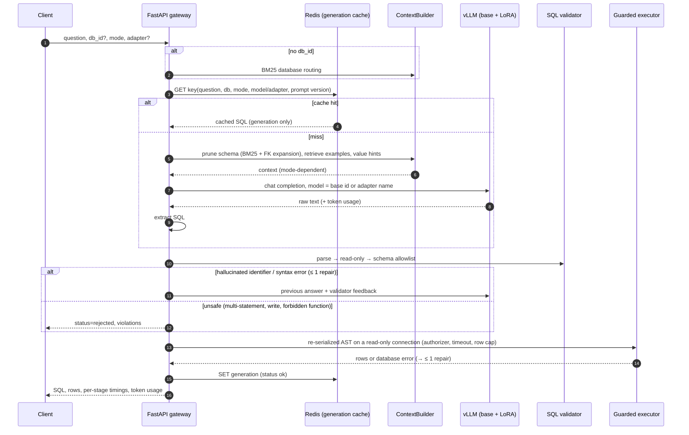
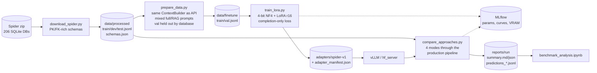
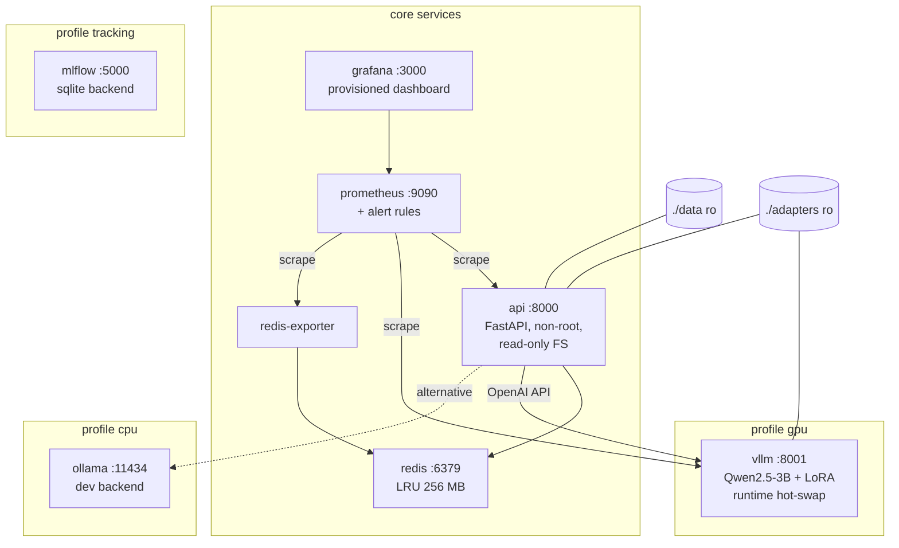

# Architecture

## 1. Request path (`POST /query`)

Every step increments Prometheus metrics, for example:

- `text2sql_stage_latency_seconds{stage=...}`
- `text2sql_validation_failures_total{reason=...}`
- `text2sql_requests_total{mode, status}`

## 2. Training and evaluation pipeline

## 3. Deployment topology (`docker compose`)

## 4. Module map

| Module | Responsibility |
|---|---|
| `src/schema.py` | `DbSchema` / `SchemaCatalog`: one schema model for retrieval, prompts, validation and execution |
| `src/retrieval/bm25.py` | BM25 with Lucene IDF + inverted index |
| `src/retrieval/schema_retriever.py` | database routing, table ranking and pruning |
| `src/retrieval/example_retriever.py` | schema-masked few-shot retrieval |
| `src/retrieval/value_index.py` | question phrases → stored cell values |
| `src/retrieval/context.py` | what each mode puts in the prompt (shared by API, eval, SFT data) |
| `src/generation/prompts.py` | versioned templates for the 4 modes; SFT example format |
| `src/generation/postprocess.py` | robust SQL extraction (never hides a second statement) |
| `src/safety/sql_validator.py` | stages 1–3 |
| `src/safety/executor.py` | stage 4 |
| `src/serving/vllm_client.py` | OpenAI-compatible client with retries; LoRA adapter registry; hot-swap |
| `src/serving/cache.py` | Redis / in-memory generation cache |
| `src/serving/telemetry.py` | Prometheus metric contract |
| `src/serving/hf_server.py` | reference server for Windows GPU boxes |
| `src/pipeline.py` | orchestration: cache → retrieve → generate → validate → repair → execute |
| `src/evaluation/` | metrics (EX, EM, hardness) and the 4-way benchmark |
| `src/finetuning/` | SFT data preparation and QLoRA training |
| `api/main.py` | HTTP layer, admin endpoints, readiness |
